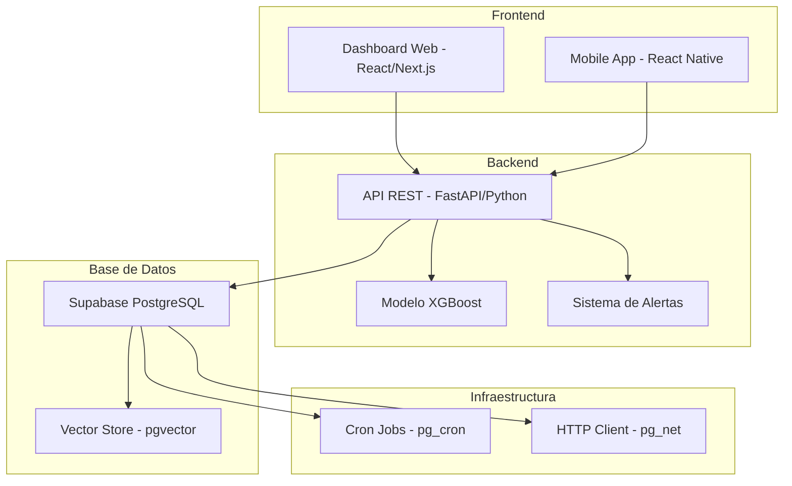
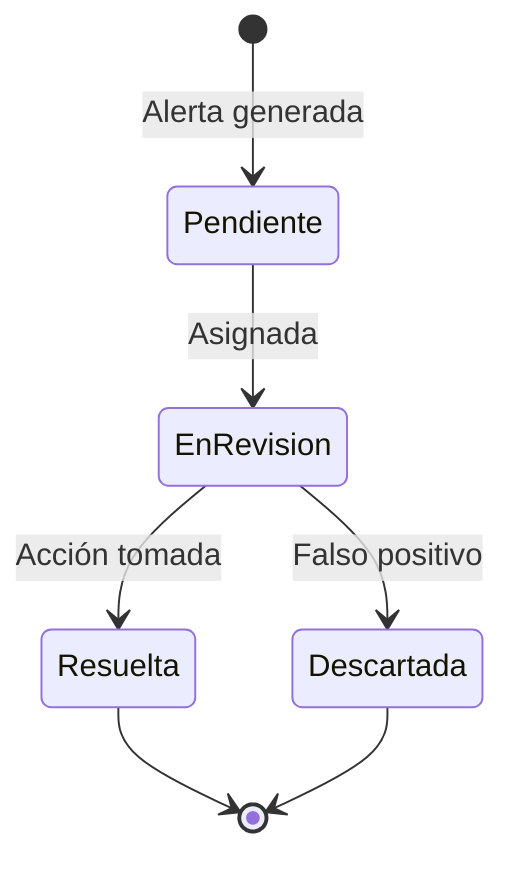

# 🏥 Sistema Predictivo de Gestión de Inventario Farmacéutico - MVP Farmacias Siman

## 📋 Resumen Ejecutivo

Sistema de inteligencia artificial para la gestión predictiva de inventario de medicamentos esenciales en Farmacias Siman (Sucursal San Pedro Sula), diseñado para mitigar quiebres de stock y optimizar la cadena de suministro mediante pronósticos con XGBoost, dashboards en tiempo real y alertas inteligentes.

### 🎯 Indicadores Clave de Éxito
- **MAPE objetivo:** < 30% (con 90 días de datos históricos)
- **Tiempo de actualización dashboards:** ≤ 15 minutos
- **Disponibilidad del sistema:** 99.5% (arquitectura objetivo)
- **Horizontes de pronóstico:** 7, 14 y 28 días

## 📚 Tabla de Contenidos

1. [Objetivos del Proyecto](#-objetivos-del-proyecto)
2. [Alcance del MVP](#-alcance-del-mvp)
3. [Arquitectura del Sistema](#-arquitectura-del-sistema)
4. [Estructura de la Base de Datos](#-estructura-de-la-base-de-datos)
5. [Modelo Predictivo XGBoost](#-modelo-predictivo-xgboost)
6. [Sistema de Alertas](#-sistema-de-alertas)
7. [Dashboards y Visualización](#-dashboards-y-visualización)
8. [Instalación y Configuración](#-instalación-y-configuración)
9. [API y Endpoints](#-api-y-endpoints)
10. [Monitoreo y Métricas](#-monitoreo-y-métricas)
11. [Roadmap Post-MVP](#-roadmap-post-mvp)

## 🎯 Objetivos del Proyecto

### Objetivo General
Diseñar un modelo informacional con capacidades predictivas para apoyar la gestión de la cadena de suministro de medicamentos esenciales en Farmacias Siman, generando dashboards y alertas útiles para la toma de decisiones.

### Objetivos Específicos
1. ✅ Identificar requisitos funcionales y no funcionales considerando condiciones tecnológicas y operativas
2. ✅ Definir enfoque de IA y técnicas de análisis para reposición de medicamentos
3. ✅ Especificar arquitectura cloud escalable y segura
4. ✅ Establecer marco de evaluación con métricas de desempeño

## 📊 Alcance del MVP

### Limitaciones del Proyecto
- ⏱️ **Tiempo:** 19 semanas de desarrollo (sin implementación operativa)
- 📈 **Datos:** 90 días históricos para validación predictiva
- 📍 **Ámbito:** Diseño conceptual para sucursal San Pedro Sula
- ⚙️ **Operación:** Sin modificación de procesos existentes
- 🎯 **Enfoque:** Arquitectura informacional con validación técnica limitada

### Funcionalidades Principales

| ID | Funcionalidad | Descripción |
|----|--------------|-------------|
| RF-01 | Modelo Predictivo | XGBoost con validación cruzada temporal, cobertura por SKU y familia ATC |
| RF-02 | Dashboards | Vistas de ventas, inventarios, pronósticos y alertas con actualización ≤15 min |
| RF-03 | Sistema de Alertas | Detección de riesgos de quiebre/vencimientos cada 4 horas |

## 🏗️ Arquitectura del Sistema

### Stack Tecnológico



### Componentes Principales

1. **Capa de Datos (Supabase)**
   - PostgreSQL con extensiones: pgvector, pg_cron, pg_net
   - Row Level Security (RLS) habilitado
   - Vistas materializadas para dashboards

2. **Capa de Procesamiento**
   - Modelo XGBoost para pronósticos
   - Motor de alertas con reglas de negocio
   - APIs RESTful con FastAPI

3. **Capa de Presentación**
   - Dashboards interactivos
   - Sistema de notificaciones
   - Reportes automatizados

## 🗄️ Estructura de la Base de Datos

### Tablas Principales

#### 1. **sku_atc** - Catálogo de Productos
```sql
- sku (PK)
- nombre_producto
- atc_code (clasificación ATC)
- lead_time_dias
- embedding (vector 384D para búsqueda semántica)
```

#### 2. **ventas_diarias** - Histórico de Ventas
```sql
- fecha, sku (PK compuesta)
- unidades_vendidas
- promo_flag
- canal
```

#### 3. **inventario_diario** - Estado del Inventario
```sql
- fecha, sku (PK compuesta)
- unidades_stock
- stock_seguridad
```

#### 4. **lotes_caducidad** - Control de Vencimientos
```sql
- lote_id (PK)
- sku
- unidades
- fecha_caducidad
```

#### 5. **forecast_historico** - Pronósticos Generados
```sql
- run_id, sku, fecha_objetivo (PK compuesta)
- unidades_pronosticadas
```

#### 6. **alertas** - Sistema de Notificaciones
```sql
- id (PK)
- tipo_alerta (ENUM: QUIEBRE_STOCK, VENCIMIENTO)
- severidad (ENUM: BAJA, MEDIA, ALTA, CRITICA)
- estado
```

### Vistas Principales para Dashboards

| Vista | Propósito | Actualización |
|-------|-----------|---------------|
| `v_latest_run` | Último modelo ejecutado | Tiempo real |
| `v_demanda_futura_7_14_28` | Pronósticos agregados | Cada 4 horas |
| `v_caducidades_30d` | Productos próximos a vencer | Tiempo real |
| `v_kpi_modelo` | Métricas de performance | Después de cada run |
| `v_alertas_abiertas` | Alertas pendientes | Tiempo real |
| `v_estado_inventario` | Estado actual completo | Tiempo real |
| `v_resumen_ejecutivo` | KPIs principales | Tiempo real |

## 🤖 Modelo Predictivo XGBoost

### Características del Modelo

```python
# Configuración base del modelo
model_config = {
    "algorithm": "XGBoost",
    "horizons": [7, 14, 28],  # días
    "training_window": 90,      # días históricos
    "validation": "time_series_cv",
    "features": [
        "lag_features",         # Valores pasados
        "rolling_statistics",   # Media, desviación móvil
        "calendar_features",    # Día semana, feriados
        "promotion_flags",      # Indicadores de promoción
        "atc_embeddings"       # Embeddings de categoría
    ]
}
```

### Pipeline de Entrenamiento

1. **Ingesta de Datos** → Extracción desde Supabase
2. **Feature Engineering** → Creación de características
3. **Validación Temporal** → Cross-validation específica para series de tiempo
4. **Entrenamiento** → XGBoost con optimización de hiperparámetros
5. **Evaluación** → MAPE, MAE, RMSE, Sesgo
6. **Persistencia** → Guardado de pronósticos y métricas

### Métricas de Evaluación

| Métrica | Objetivo | Descripción |
|---------|----------|-------------|
| MAPE | < 30% | Error porcentual absoluto medio |
| MAE | Minimizar | Error absoluto medio |
| RMSE | Minimizar | Raíz del error cuadrático medio |
| Sesgo | ≈ 0 | Tendencia sistemática del modelo |
| R² | > 0.7 | Varianza explicada |

## 🚨 Sistema de Alertas

### Tipos de Alertas

#### 1. **Quiebre de Stock**
- Trigger: Stock < Stock de Seguridad
- Severidad: Basada en criticidad del medicamento
- Acción: Orden de compra urgente

#### 2. **Vencimiento**
- Trigger: Fecha caducidad < 30 días
- Severidad: Según días restantes
- Acción: Promoción o devolución

#### 3. **Sobrestock** (Futuro)
- Trigger: Stock > 150% del máximo
- Severidad: Según valor económico
- Acción: Detener reposición

#### 4. **Demanda Anómala** (Futuro)
- Trigger: Variación > 200% del promedio
- Severidad: Según impacto
- Acción: Revisión manual

### Flujo de Gestión de Alertas



## 📊 Dashboards y Visualización

### Dashboard Principal - KPIs Ejecutivos

```
┌─────────────────────────────────────────────────────────────┐
│                    RESUMEN EJECUTIVO                        │
├──────────────┬──────────────┬──────────────┬──────────────┤
│ Sin Stock    │ Stock Crítico│ Alertas      │ MAPE Modelo  │
│     12       │      28      │     15       │    24.5%     │
├──────────────┴──────────────┴──────────────┴──────────────┤
│                  TENDENCIA DE VENTAS (30d)                  │
│ [Gráfico de líneas con ventas diarias]                     │
├─────────────────────────────────────────────────────────────┤
│              PRODUCTOS CRÍTICOS - TOP 10                    │
│ [Tabla con SKU, Stock, Días cobertura, Acción]            │
└─────────────────────────────────────────────────────────────┘
```

### Dashboards Específicos

1. **Dashboard de Inventario**
   - Estado actual por SKU
   - Días de cobertura
   - Análisis ABC
   - Mapa de calor por categoría ATC

2. **Dashboard de Pronósticos**
   - Demanda proyectada 7/14/28 días
   - Intervalos de confianza
   - Comparación real vs pronóstico
   - Métricas de precisión por SKU

3. **Dashboard de Alertas**
   - Bandeja de entrada
   - Priorización por score
   - Tiempo promedio de resolución
   - Historial de acciones

4. **Dashboard de Caducidades**
   - Timeline de vencimientos
   - Valor en riesgo
   - Lotes por vencer (7/30/60 días)
   - Sugerencias de acción

## 🚀 Instalación y Configuración

### Prerrequisitos

```bash
# Versiones requeridas
- Python 3.9+
- Node.js 18+
- PostgreSQL 14+
- Supabase CLI
```

### 1. Configuración de Supabase

```bash
# Clonar el repositorio
git clone https://github.com/tu-org/farmacias-siman-mvp.git
cd farmacias-siman-mvp

# Configurar variables de entorno
cp .env.example .env
# Editar .env con tus credenciales de Supabase
```

### 2. Instalación del Backend (Python)

```bash
# Crear entorno virtual
python -m venv venv
source venv/bin/activate  # En Windows: venv\Scripts\activate

# Instalar dependencias
pip install -r requirements.txt

# Configurar la API
cd backend
uvicorn main:app --reload --port 8000
```

### 3. Instalación del Frontend

```bash
# Instalar dependencias
cd frontend
npm install

# Configurar variables de entorno
cp .env.local.example .env.local
# Editar .env.local con URL de Supabase y anon key

# Iniciar servidor de desarrollo
npm run dev
```

### 4. Configuración de Jobs Programados

```sql
-- En Supabase SQL Editor
-- Los jobs ya están configurados en el schema:

-- Forecast cada 4 horas
SELECT cron.schedule('forecast_4h', '0 */4 * * *', 
  $$ SELECT public.call_forecast(); $$);

-- Limpieza semanal
SELECT cron.schedule('cleanup_weekly', '0 2 * * 0', 
  $$ SELECT public.cleanup_old_data(); $$);
```

## 🔌 API y Endpoints

### Endpoints Principales

#### Pronósticos
```http
POST /api/forecast
{
  "horizonte_dias": 28,
  "skus": ["SKU001", "SKU002"] // opcional, todos si no se especifica
}

GET /api/forecast/latest
GET /api/forecast/{run_id}
```

#### Alertas
```http
GET /api/alertas?estado=PENDIENTE&severidad=ALTA
POST /api/alertas/{id}/acknowledge
{
  "comentario": "Orden de compra generada #OC-2024-001"
}
```

#### Inventario
```http
GET /api/inventario/estado
GET /api/inventario/criticos
GET /api/inventario/abc-analysis
```

#### Métricas
```http
GET /api/metricas/modelo
GET /api/metricas/kpis
GET /api/metricas/dashboard/{tipo}
```

### Autenticación

```javascript
// Ejemplo de autenticación con Supabase
import { createClient } from '@supabase/supabase-js'

const supabase = createClient(
  process.env.NEXT_PUBLIC_SUPABASE_URL,
  process.env.NEXT_PUBLIC_SUPABASE_ANON_KEY
)

// Login
const { data, error } = await supabase.auth.signInWithPassword({
  email: 'usuario@farmacia.com',
  password: 'password'
})
```

## 📈 Monitoreo y Métricas

### KPIs del Sistema

| Categoría | Métrica | Objetivo | Frecuencia |
|-----------|---------|----------|------------|
| **Modelo** | MAPE promedio | < 30% | Cada run |
| **Modelo** | % SKUs MAPE < 30% | > 70% | Cada run |
| **Inventario** | % Quiebres de stock | < 5% | Diario |
| **Inventario** | Días promedio cobertura | > 14 | Diario |
| **Alertas** | Tiempo resolución | < 4 horas | Por alerta |
| **Alertas** | % Falsos positivos | < 10% | Semanal |
| **Sistema** | Disponibilidad | > 99.5% | Continuo |
| **Sistema** | Latencia API p95 | < 500ms | Continuo |

### Queries de Monitoreo

```sql
-- Estado general del sistema
SELECT * FROM public.v_resumen_ejecutivo;

-- Calidad del modelo
SELECT * FROM public.v_kpi_modelo;

-- Productos críticos
SELECT * FROM public.v_estado_inventario 
WHERE estado_stock IN ('SIN_STOCK', 'CRITICO')
ORDER BY es_esencial DESC, dias_inventario_disponible;

-- Alertas pendientes prioritarias
SELECT * FROM public.v_alertas_activas 
WHERE score_prioridad > 70
ORDER BY score_prioridad DESC;
```

## 🗺️ Roadmap Post-MVP

### Fase 1: Estabilización (Meses 1-2)
- [ ] Ajuste fino del modelo con datos reales
- [ ] Calibración de umbrales de alertas
- [ ] Capacitación del personal
- [ ] Documentación operativa

### Fase 2: Expansión (Meses 3-4)
- [ ] Integración con sistema ERP
- [ ] Modelo de optimización de pedidos
- [ ] Análisis de proveedores
- [ ] Dashboard móvil nativo

### Fase 3: Inteligencia Avanzada (Meses 5-6)
- [ ] Deep Learning para patrones complejos
- [ ] Optimización multi-objetivo
- [ ] Análisis predictivo de promociones
- [ ] Sistema de recomendaciones

### Fase 4: Escalamiento (Meses 7+)
- [ ] Expansión a otras sucursales
- [ ] Integración con cadena de suministro
- [ ] Analytics avanzado
- [ ] IA Generativa para insights

## 📝 Notas de Implementación

### Consideraciones Importantes

1. **Limitación de Datos**: Con solo 90 días de histórico, el modelo puede tener menor precisión en:
   - Estacionalidades anuales
   - Eventos especiales no recurrentes
   - Productos nuevos sin historial

2. **Mejoras Recomendadas**:
   - Implementar transfer learning desde productos similares
   - Usar embeddings de productos para cold-start
   - Incorporar datos externos (clima, epidemiología)

3. **Seguridad**:
   - RLS habilitado en todas las tablas
   - API keys rotadas mensualmente
   - Logs de auditoría completos
   - Encriptación en tránsito y reposo

4. **Performance**:
   - Índices optimizados para queries frecuentes
   - Vistas materializadas para dashboards
   - Cache Redis para endpoints críticos
   - CDN para assets estáticos

## 🤝 Contribuidores

- **Product Owner**: Dirección de Farmacia
- **Technical Lead**: Equipo de Desarrollo
- **Data Scientists**: Modelo Predictivo
- **UX/UI**: Diseño de Dashboards
- **QA**: Validación y Testing

## 📄 Licencia

Proyecto privado - Farmacias Siman © 2024

---

## 📞 Soporte

Para soporte técnico o consultas sobre el sistema:
- 📧 Email: soporte-mvp@farmaciassiman.com
- 📱 Slack: #canal-mvp-inventario
- 📚 Wiki: [Documentación Interna](https://wiki.interno.com/mvp-inventario)

---

**Versión**: 1.0.0  
**Última actualización**: Diciembre 2024  
**Estado**: En desarrollo (MVP)